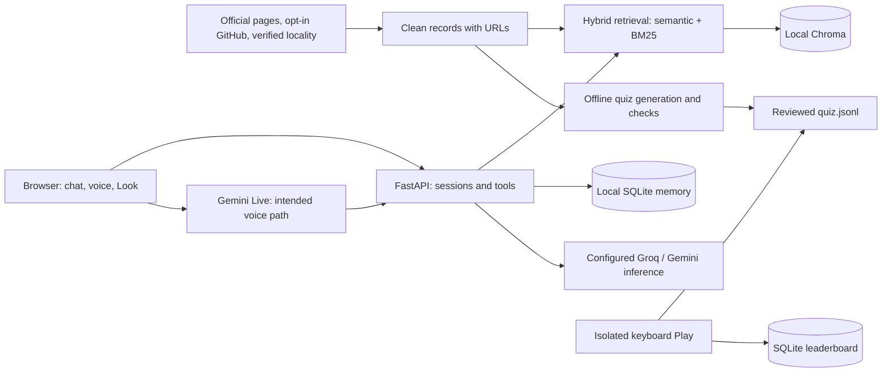

# Hello Campus

Hello Campus is a campus companion for Anjuman Institute of Technology and Management (AITM), Bhatkal. It helps visitors find campus information, discover consenting students' public work and resume conversations across devices, with source links and bounded visitor memory.

## Problem

A guest arriving for a talk, judging session or hiring visit needs practical answers: where to go, what students are building and where to eat. Those answers are scattered across campus pages, GitHub profiles, schedules and local knowledge. Hello Campus brings them into a conversational interface with a friendly Guide and a factual Analyst. Unsupported questions should receive an honest refusal rather than invented campus facts.

## Current status

This branch contains isolated quiz, keyboard Play and documentation work for the cloud pivot. Main-app integration is being handled separately. Formal pivot addenda are not present in this checkout; [review notes](monitor/REVIEW.md), [pitch](monitor/PITCH.md) and [game proposal](monitor/PROPOSAL-buzzer-quiz.md) describe the direction. The proposal's draft label is not a completion report.

| Area | Present here | Remaining |
|---|---|---|
| Chat and retrieval | Guide/Analyst, Ollama client, Chroma semantic retrieval, source chips and threshold refusal | Cloud providers, hybrid retrieval and integrated verification |
| Memory | SQLite profiles, extracted facts, shortlist and resume codes | Verify new voice/tool paths preserve the same rules |
| Hiring | Role intake, URL-filtered evidence, matching, comparison, interview kit, export and README improvement | Real opted-in records and representative demo |
| Campus data | Three campus records and one achievement record | More sources, verified locality entries and a schedule |
| Play | Isolated quiz generation, keyboard versus/co-op and SQLite leaderboard | Main-app navigation/router integration |
| Live voice and Look | Target architecture below | Provider wiring, real calls, device checks and measurements |
| Gesture game | Keyboard play needs no model or camera | Training, weights, runtime integration and venue checks |

The main app currently imports deleted speech/vision components in `backend/components.py` and `frontend/src/App.tsx`. Old full-app startup/build commands therefore do not demonstrate a working pivot. Historical test counts and local speech timings do not certify this branch.

## Architecture

The target cloud pivot retains local data, retrieval and visitor state while moving conversational inference and live media to configured providers. Cloud, hybrid retrieval, Live and Look paths below describe intended integration, not a working deployment claim.



Chat, Live and Look should share grounded tools. Look is intended to resolve a visitor-requested poster snapshot against verified event/schedule data, without continuously streaming video. Play is separate: no model call occurs during a game, and keyboard controls work without gesture weights.

## RAG and evidence

Source records carry an ID, collection, title, text, source URL, check date and optional entity metadata. Collections cover campus, achievements, students and locality. Scraping respects robots.txt, identifies its User-Agent, throttles requests and caches raw responses. Refreshing sources is separate from answering a visitor.

The retained baseline makes overlapping chunks, embeds them through Ollama/nomic and upserts persistent Chroma collections. Ingestion deletes stale chunks. Retrieval ranks by cosine similarity and applies a configurable confidence threshold. Generation receives selected passages and bounded history; citation chips retain evidence references.

The pivot design combines semantic retrieval and BM25 keyword retrieval with rank fusion. Embedding models and fused ranks have different score distributions: the old cosine threshold cannot be blindly reused or applied to a reciprocal-rank score. Confidence gates and multilingual behavior need evaluation against real campus questions before claiming retrieval quality. This hybrid migration is outside this isolated branch.

Grounding checks differ by feature:

- **Chat:** retrieved context, confidence refusal and visible sources. A citation alone does not prove every generated sentence.
- **Hiring:** evidence URLs must match URLs already stored for a currently consenting student. This blocks invented links; it does not independently establish every claim's wording.
- **Quiz:** the source URL must exist in the input data, evidence must be a verbatim substring of the cited record, and the correct option text must appear in that evidence. Reject failures and have a human skim the accepted bank before committing it.

## Keyboard Play

Generate questions ahead of time from `data/clean/*.jsonl`, saving `data/clean/quiz.jsonl`. Each item contains `id`, `question`, four `options`, `answer_index`, `source_url` and `evidence`. Playing a reviewed bank needs no provider quota. With fewer than five valid questions, show that more campus data is needed.

- **Versus:** `A` buzzes for player 1 and `L` for player 2. The locked player answers with `1`–`4`. A correct answer earns one point; a wrong answer or timeout offers the other player one attempt.
- **Co-op:** player 1 uses `1`–`4`; player 2 uses `7`, `8`, `9`, `0` for options 1–4. Matching selections lock the team answer. The scoreboard tracks team score and streak bonus against a question timer.
- **Results:** reveal the correct answer and source; persist completed scores in SQLite and show today's top ten. Player names are typed, never inferred from a camera.

Main-app navigation and router wiring remain with the integration owner. The standalone preview runs independently of the broken main-app entry points. From the repository root, start the API:

```powershell
.venv\Scripts\python -m uvicorn backend.quiz.api:app --host 127.0.0.1 --port 8001
```

In a second terminal:

```powershell
npm.cmd run dev --prefix frontend -- --port 5174
```

Open [the standalone Play preview](http://localhost:5174/play.html?api=http://127.0.0.1:8001/api/quiz). Completed games persist in `data/quiz.sqlite3`, independently of visitor memory. The server derives scores from submitted game actions rather than trusting a client-posted score. Main-app integration uses the quiz router and the new `PlayMode` component with `/api/quiz` as its default API base.

To produce the extractive draft from the supplied review candidates:

```powershell
.venv\Scripts\python -m backend.quiz --candidates backend/quiz/review-candidates.json
```

`make quiz` delegates to `python -m backend.quiz` where Make is available. The supplied candidates use real AITM evidence but still need human review. Online generation can use the configured provider adapter; generation is never part of gameplay. The evidence post-check also applies to supplied candidates.

## Data and privacy

Student ingestion is opt-in. Use `data/students_optin.csv` with `name,github_username,headline,consent`; public GitHub visibility alone is not consent. Scraping, indexing, retrieval and hiring endpoints check the current consent list. Revocation hides stale student records from subsequent retrieval/API results; previously viewed or exported information cannot be recalled.

Locality placeholders must not be indexed or presented as verified recommendations. Real entries need verification and check dates. The empty student list and placeholder locality entries are data gaps, not evidence of working hiring or lunch recommendations.

Visitor profiles, extracted facts and shortlists persist in local SQLite. By default only the last **ten messages** remain, counting individual user/assistant messages rather than conversation pairs. Extracted facts can outlive that window. Resume codes grant profile access and should be shared carefully; they are convenience mechanisms, not strong authentication. Leaderboard names, modes, scores and timestamps also persist locally.

The design excludes face recognition and identity inference. Microphone and camera access must follow visitor action and browser permission. The application is not intended to persist audio or snapshots. Under the cloud pivot, enabled features send relevant media, prompts, retrieved passages and necessary visitor context to configured providers. **The pivot is not local-only processing.** Review provider retention/account settings and check the final implementation before claiming the media paths are privacy-verified. Keep sensitive information out of demo records and provider keys out of browser code and committed files.

## Setup and validation

Existing tooling uses Python 3.10/3.11 and Node.js 22.18+. From the repository root:

```powershell
python -m venv .venv
.venv\Scripts\python -m pip install -r backend/requirements.txt
npm.cmd install --prefix frontend
```

On Linux/macOS use `.venv/bin/python` and `npm`. Installing dependencies does not fix the current main-app import regressions. Old speech/model-download instructions are not pivot setup instructions.

The team will fill these measurements from the integrated build. Old-stack timings and synthetic detector tests are not substitutes.

| Measurement | Result |
|---|---|
| RAG dataset size and retrieval hit rate | Pending — team to measure |
| Grounded-answer and refusal evaluation | Pending — team to measure |
| Chat first-token and end-to-end latency | Pending — team to measure |
| Live voice roundtrip and interruption | Pending — team to measure |
| Provider usage, cost and quota behavior | Pending — team to measure |
| Quiz items surviving checks and human review | Pending — team to measure |
| Full keyboard games and leaderboard restart check | Pending — team to measure |
| Gesture mAP50, precision/recall and CPU latency | Pending — team to measure |
| Two-player gesture attribution and answer accuracy | Pending — team to measure |
| Phone HTTPS microphone/camera checks | Pending — team to measure |

## Sources and licenses

AITM content remains owned by its rights holders; retain source URLs and check dates. Public GitHub content retains its repository licenses. Dependencies, model weights and cloud services have separate terms to review before redistribution or deployment.

The proposed gesture dataset is the `cj-mills/hagrid-sample-120k-384p` derivative of HaGRID, with CC-BY-SA-4.0 attribution requirements described in the [game proposal](monitor/PROPOSAL-buzzer-quiz.md). No dataset images, trained weights, training results or license clearance are claimed here. Keyboard Play does not depend on those artifacts.
